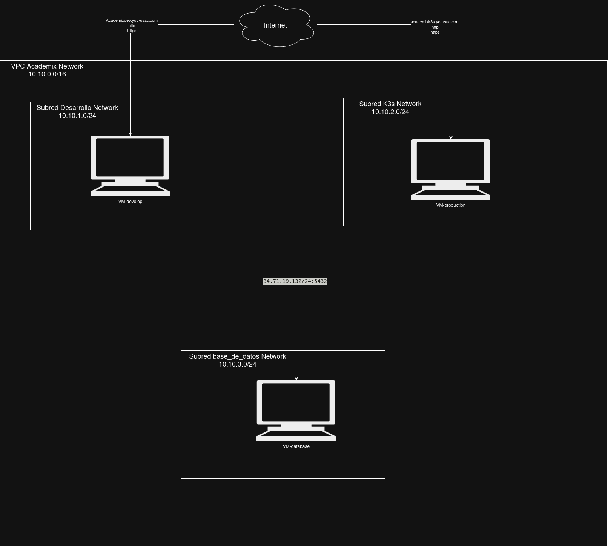
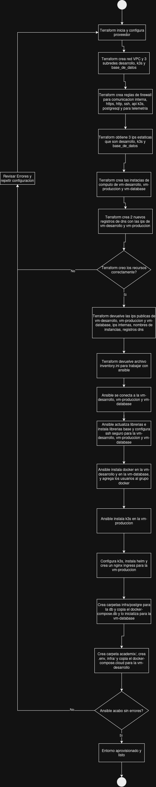

# Informe Técnico — Práctica 10

**Observabilidad, Monitoreo y Despliegue en Clúster**
Plataforma Academix Pass & CertiHub — Proyecto Fase 3.

Universidad de San Carlos de Guatemala
Facultad de Ingeniería
Escuela de Ciencias y Sistemas

> Responsable: Heinz Gómez — Carné 199819617

---

## Índice

- [Informe Técnico — Práctica 10](#informe-técnico--práctica-10)
  - [Índice](#índice)
  - [1. Introducción](#1-introducción)
  - [2. Arquitectura de red en la nube](#2-arquitectura-de-red-en-la-nube)
    - [2.1 Diagrama de la red](#21-diagrama-de-la-red)
    - [2.2 Subredes e instancias](#22-subredes-e-instancias)
    - [2.3 Tablas de enrutamiento](#23-tablas-de-enrutamiento)
    - [2.4 Reglas de firewall y puertos](#24-reglas-de-firewall-y-puertos)
    - [2.5 Resolución de nombres (DNS)](#25-resolución-de-nombres-dns)
  - [3. Ansible: configuración de las máquinas](#3-ansible-configuración-de-las-máquinas)
  - [4. Flujo del aprovisionamiento](#4-flujo-del-aprovisionamiento)
  - [5. Matriz de decisiones técnicas](#5-matriz-de-decisiones-técnicas)
    - [5.1 Prometheus y Grafana para la observabilidad](#51-prometheus-y-grafana-para-la-observabilidad)
    - [5.2 Kubernetes con K3s como plataforma de despliegue](#52-kubernetes-con-k3s-como-plataforma-de-despliegue)
    - [5.3 Doble entorno: Docker Compose (develop) y K3s (producción)](#53-doble-entorno-docker-compose-develop-y-k3s-producción)
  - [6. Conclusiones](#6-conclusiones)

---

## 1. Introducción

Esta práctica añade al sistema Academix Pass & CertiHub las tres capas que faltaban para operarlo como un producto real: observabilidad por servicio, monitoreo del conjunto y un despliegue con semántica de producción.

La observabilidad se incorporó a los cinco servicios backend de forma uniforme. Cada uno emite logs estructurados en JSON (pino en Node, winston en Python, log estándar con campos clave en Go), expone un liveness en `/health` y un readiness en `/health/ready` que comprueba sus dependencias (PostgreSQL, Redis y el broker), y publica métricas en formato Prometheus en `/metrics`. Las claves y contraseñas se redactan de los logs y las métricas llevan nombres y etiquetas comunes (`academix_rpc_calls_total`, `academix_worker_messages_total`, entre otras) para que un único tablero pueda observar servicios escritos en tres lenguajes distintos.

El monitoreo del conjunto se resolvió con Prometheus y Grafana, más cadvisor y node-exporter para la capa de infraestructura. Prometheus raspa cada `/metrics` y el endpoint de métricas de RabbitMQ (`/metrics/per-object`, que agrega las etiquetas `queue=` y `vhost=`), guarda 15 días de histórico y evalúa reglas de alerta básicas. Grafana aprovisiona dos tableros —Infraestructura y Métricas de Negocio y Colas— desde archivos versionados en el repositorio, de modo que el tablero es parte del código y no un estado oculto en la base de datos de Grafana.

El despliegue de producción se resolvió con un clúster K3s de un nodo sobre la VM `vm-production-k3s` aprovisionada en la práctica anterior. Los manifiestos viven en la carpeta `k3s/`, organizados por kind (deployments, services, configmaps, secrets, namespaces, ingress y monitoring), y cubren el backend completo: gateway, los cuatro servicios, RabbitMQ y Redis con sus volúmenes persistentes, y el stack de monitoreo. El tráfico externo entra por ingress-nginx (instalado con Helm y `hostNetwork`) y TLS lo emite cert-manager con Let's Encrypt. El frontend corre en Vercel y la base de datos en una VM dedicada; el único punto de entrada del clúster es el api-gateway, publicado por un Ingress con host.

Finalmente, el frontend incorporó un simulador de inscripción en ráfaga que dispara solicitudes reales contra el gateway: crea usuarios de prueba en paralelo y luego lanza la ráfaga de reservas con un token por estudiante, lo que permite demostrar en vivo cómo la cola absorbe el pico y cómo los workers lo drenan sin sobreventa, observándolo todo en los tableros de Grafana.

---

## 2. Arquitectura de red en la nube

Entorno: proyecto fiery-nimbus-508806-i4, región us-central1, zona us-central1-a.

### 2.1 Diagrama de la red



Los tres servicios de Google Cloud habilitados por el código son Compute Engine y Cloud DNS; la zona DNS yo-usac-com no la crea el proyecto, solo se consulta como fuente de datos.

### 2.2 Subredes e instancias

| Subred | Rango CIDR | Instancia | IP interna | IP externa (fija) | Tipo | Disco |
|---|---|---|---|---|---|---|
| academix-network-desarrollo | 10.10.1.0/24 | vm-development | 10.10.1.2 | academix-ip-desarrollo | e2-medium | 10 GB pd-balanced |
| academix-network-k3s | 10.10.2.0/24 | vm-production-k3s | 10.10.2.2 | academix-ip-k3s | e2-standard-2 | 25 GB pd-balanced |
| academix-network-base-de-datos | 10.10.3.0/24 | vm-database | 10.10.3.2 | academix-ip-base-de-datos | e2-medium | 15 GB pd-balanced |

Las tres direcciones IP externas son estáticas y reservadas por Terraform, de modo que sobreviven a un reinicio de la máquina y no cambian al destruir y recrear la infraestructura. Toda la red interna cae dentro del rango 10.10.0.0/16.

### 2.3 Tablas de enrutamiento

La VPC se crea con subredes automáticas desactivadas y modo de enrutamiento REGIONAL, por lo que las rutas efectivas son las siguientes:

| Ruta | Destino | Próximo salto | Origen |
|---|---|---|---|
| Ruta predeterminada a Internet | 0.0.0.0/0 | Internet Gateway | Creada automáticamente por Google Cloud al crear la VPC |
| Ruta de la subred de desarrollo | 10.10.1.0/24 | Red local | Implícita al crear la subred |
| Ruta de la subred de K3s | 10.10.2.0/24 | Red local | Implícita al crear la subred |
| Ruta de la subred de base de datos | 10.10.3.0/24 | Red local | Implícita al crear la subred |

No se definió Cloud Router ni Cloud NAT: cada instancia sale a Internet por su propia dirección externa estática, que es además la que resuelven los registros DNS. El tráfico este-oeste entre las tres subredes viaja por la red local sin salir a Internet, y está permitido íntegramente por la regla interna.

### 2.4 Reglas de firewall y puertos

Todas las reglas son de tipo INGRESS con prioridad 1000 y se aplican mediante etiquetas de instancia, no a la red completa.

| Regla | Protocolo y puertos | Origen permitido | Etiquetas de destino |
|---|---|---|---|
| academix-allow-internal | TCP, UDP e ICMP (todos los puertos) | 10.10.0.0/16 | academix |
| academix-allow-ssh | TCP 22 | 0.0.0.0/0 | academix |
| academix-allow-http-https | TCP 80 y 443 | 0.0.0.0/0 | web |
| academix-allow-k3s-api | TCP 6443 | 0.0.0.0/0 | k3s |
| academix-allow-postgres | TCP 5432 | 10.10.0.0/16 | database |
| academix-allow-telemetry | TCP 3000, 9090 y 9100 | 10.10.0.0/16 | academix |

Flujos resultantes:

- Norte-sur (desde Internet): SSH 22 hacia las tres máquinas, HTTP y HTTPS 80/443 hacia vm-development y vm-production-k3s, y API de Kubernetes 6443 hacia vm-production-k3s.
- Este-oeste (dentro de la VPC): todo el tráfico entre las tres subredes, sobre el cual se superponen las reglas explícitas de PostgreSQL 5432 (pods de K3s contra vm-database) y de telemetría.
- Excluido deliberadamente: PostgreSQL y los puertos de telemetría no están abiertos a Internet, solo al rango interno 10.10.0.0/16. La dirección IP de quien ejecuta los comandos es dinámica, por lo que restringirla en SSH y en la API de Kubernetes haría perder el acceso en cuanto cambie; en su lugar, la telemetría se deja cerrada y se recomienda usar un túnel SSH para consultarla.

### 2.5 Resolución de nombres (DNS)

| Registro | Tipo | TTL | Destino |
|---|---|---|---|
| academixdev.yo-usac.com | A | 60 | IP externa de vm-development |
| academixk3s.yo-usac.com | A | 60 | IP externa de vm-production-k3s |

Ambos registros pertenecen a la zona yo-usac-com, que se toma como fuente de datos y no se modifica. El registro academix.yo-usac.com, que apunta al servicio de front-end desplegado en la plataforma externa, no es gestionado por este código y queda intacto.

---

## 3. Ansible: configuración de las máquinas

Terraform crea la infraestructura; Ansible la configura. Después de Terraform las tres máquinas existen sin ningún software instalado. Ansible se conecta a cada una por SSH y ejecuta los pasos en orden hasta dejar el sistema listo.

Paso 1 — Base (las tres máquinas)

Primero corre apt update para actualizar el índice de paquetes, luego apt upgrade para instalar las actualizaciones disponibles. Después instala las utilidades básicas que los demás pasos van a necesitar: git, curl, htop, vim, unzip y otras herramientas del sistema. Por último ajusta la configuración de SSH para deshabilitar el acceso por contraseña y el login como root, y reinicia el servicio SSH si el archivo cambió.

Paso 2 — Docker (máquina de desarrollo y máquina de base de datos)

Agrega la clave GPG oficial de Docker y su repositorio al sistema. Luego instala Docker Engine junto con el plugin de Compose y el plugin de Buildx. Habilita el servicio de Docker para que arranque automáticamente con el sistema. Finalmente agrega el usuario ubuntu al grupo docker para que pueda ejecutar comandos sin necesitar sudo.

Paso 3 — K3s (máquina de producción)

Desactiva el swap, que K3s necesita tener apagado para funcionar. Descarga el instalador oficial de K3s y lo ejecuta en modo servidor, configurando la IP pública del nodo como dirección válida en el certificado TLS y desactivando el Traefik que viene incluido por defecto. Espera a que el nodo aparezca en estado listo. Luego copia el archivo de configuración de kubectl al equipo local y reemplaza la dirección 127.0.0.1 por la IP pública, dejando el clúster accesible desde fuera.

Paso 4 — Ingress (máquina de producción)

Instala Helm. Usa Helm para desplegar ingress-nginx configurado para escuchar directamente en los puertos 80 y 443 del nodo, sin necesitar un balanceador de carga externo. También despliega cert-manager. Una vez que ambos controladores están activos, crea el emisor de certificados apuntando a Lets Encrypt en modo producción para que los certificados TLS se emitan automáticamente.

Paso 5 — Entorno (máquina de desarrollo y máquina de base de datos)

Crea el directorio de la aplicación y escribe el archivo de variables de entorno con todas las configuraciones y contraseñas necesarias, con permisos de lectura restringidos al propietario. En la máquina de desarrollo además copia el archivo docker compose de producción cloud y el script de inicialización de la base de datos. Al terminar descarga las imágenes Docker necesarias y levanta todos los servicios en segundo plano.

Paso 6 — Base de datos (máquina de base de datos)

Copia el archivo docker compose de PostgreSQL y levanta el contenedor. Espera a que PostgreSQL acepte conexiones, revisando cada cinco segundos hasta 30 intentos. Cuando el servidor responde, verifica que las cuatro bases de datos requeridas existen: auth_db, talleres_db, reservas_db y certificados_db. Si alguna falta, el paso falla con un mensaje indicando cuál no se encontró.

Paso 7 — Despliegue en K3s (máquina de producción)

Es el último paso porque depende de que el ingress y la base de datos ya estén funcionando. Copia los manifiestos de Kubernetes al nodo y sustituye la variable de tag de imagen por el valor configurado. Luego los aplica en el orden correcto: primero los namespaces, luego los secrets y configmaps, después los deployments y services, el ingress y finalmente el stack de monitoreo. Espera el rollout de cada componente en orden: primero RabbitMQ y Redis, luego los microservicios y el gateway, y por último Prometheus y Grafana.

---

## 4. Flujo del aprovisionamiento



Detalle de cada etapa:

1. Terraform plan — compara el código con el estado guardado y muestra qué se crearía, modificaría o destruiría, sin tocar nada. Es el paso de revisión.
2. Terraform apply — ejecuta el plan. En la primera pasada crea la VPC, las tres subredes, las seis reglas de firewall, las tres IP estáticas, las tres instancias y los dos registros DNS. En pasadas siguientes solo ajusta lo que difiere.
3. Estado — el archivo .tfstate registra el recurso real de cada elemento declarado. Es lo que permite que Terraform detecte cambios hechos fuera del código y que se pueda re-ejecutar cuantas veces haga falta sin duplicar recursos.
4. Ansible — toma el inventario generado desde la propia salida de Terraform y conecta por SSH a cada máquina para llevarla al estado deseado, en el orden documentado en el archivo site.yml:

```
01 base      → actualización de repositorios, utilitarios y endurecimiento de SSH   (las 3 VMs)
02 docker    → motor Docker, Docker Compose y grupo docker                          (vm-development, vm-database)
03 k3s       → instalación de K3s como servidor/control-plane y extracción          (vm-production-k3s)
              del kubeconfig a la máquina de administración
04 ingress   → controlador ingress-nginx, cert-manager y emisor de                 (vm-production-k3s)
              Let's Encrypt
05 entorno   → carpeta academix/ con su archivo de entorno y estructura de carpetas (vm-development, vm-database)
06 db        → compose de PostgreSQL, script de inicialización y arranque           (vm-database)
```

5. Listo — al terminar, las tres máquinas quedan configuradas y el sistema puede desplegar las imágenes de la aplicación sobre ellas.

---

## 5. Matriz de decisiones técnicas

### 5.1 Prometheus y Grafana para la observabilidad

| Decisión técnica | Qué | Por qué | Para qué |
|---|---|---|---|
| Prometheus para la recolección de métricas y Grafana para los tableros | Prometheus es una base de datos de series temporales y un motor de raspa (scrape): cada servicio expone sus métricas en formato de texto Prometheus sobre `/metrics` y el servidor las consulta cada 15 segundos, guarda 15 días de histórico y evalúa reglas de alerta. Grafana se conecta a Prometheus como datasource y aprovisiona los tableros desde archivos JSON versionados en el repositorio (carpeta `monitoring/`, migrada a ConfigMaps en `k3s/monitoring/`). El conjunto completo incluye cadvisor y node-exporter como DaemonSets para las métricas de contenedores y del nodo. | Se evaluaron tres alternativas. Los logs por sí solos no responden preguntas de estado ni de tendencia: "¿cuánta cola hay ahorita?", "¿en qué momento empezó a caer el gateway?" o "¿cuánto consumo de memoria lleva el worker?" solo se contestan con métricas históricas. Un stack ELK (Elasticsearch, Logstash, Kibana) habría unificado logs y métricas, pero pesa varias veces más en RAM (mínimo 4 GB solo para Elasticsearch) y su curva de configuración excede el alcance de un laboratorio. Los APM gestionados (Datadog, New Relic) resuelven el problema con cero operación, pero son de pago y envían los datos del sistema a un tercero, lo que contradice el objetivo de tener la plataforma bajo control propio. Prometheus es el estándar de facto en el ecosistema Kubernetes, ligero (un binario, sin dependencias externas), y su formato de métricas es el mismo que ya exponían prom-client (Node), prometheus_client (Python) y client_golang (Go); Grafana se integra con él de forma nativa. | Responder en la demo, en vivo y sin acceso a la terminal de los servidores, dos preguntas: ¿la ráfaga de inscripciones se está drenando? (tablero "Métricas de Negocio y Colas": longitud de `reservas.solicitudes`, tasa de procesamiento de los workers, métricas RPC por operación y estado) y ¿la infraestructura lo está soportando? (tablero "Infraestructura": CPU, memoria y red por contenedor y por nodo). Además, con 15 días de histórico y las alertas `TargetDown`, `ColaSaturada` y `MemoriaContenedorAlta` queda material para diagnosticar un incidente ocurrido horas o días atrás, no solo uno en curso. |

### 5.2 Kubernetes con K3s como plataforma de despliegue

| Decisión técnica | Qué | Por qué | Para qué |
|---|---|---|---|
| K3s como clúster Kubernetes de un nodo para el entorno de producción | K3s es una distribución de Kubernetes empaquetada en un binario único, sin componentes innecesarios, que corre como servicio del sistema en la VM `vm-production-k3s`. Sobre él se despliega el backend completo con manifiestos estándar de Kubernetes (`k3s/`: deployments, services, configmaps, secrets, PVCs e ingress): cada servicio tiene sus probes de liveness y readiness, estrategia RollingUpdate sin caída (`maxUnavailable: 0`), límites de recursos ajustados a la VM de 8 GB, y tráfico externo vía ingress-nginx con TLS de cert-manager. | Se compararon cuatro opciones. Docker Compose en la VM de producción habría sido la continuación más directa del entorno de desarrollo, pero no ofrece orquestación: no reinicia un contenedor que muere, no tiene probes (el gateway seguiría recibiendo tráfico con el broker caído), no hace actualizaciones sin ventana de caída, no separa configuración de secretos a nivel de plataforma y no escala un servicio sin reescribir el archivo. Docker Swarm resuelve parte de eso, pero su ecosistema prácticamente se detuvo en 2017 y todo lo que se construya sobre él (ingress, cert-manager, dashboards) queda fuera del camino estándar de la industria. Un clúster GKE gestionado eliminaría el trabajo de operar el plano de control, pero introduce costo fijo mensual y una superficie de configuración que no aporta nada a un nodo único de laboratorio. K3s entrega la semántica completa de Kubernetes (los mismos manifiests, la misma API, el mismo `kubectl`) en un binario de menos de 100 MB que instala Ansible en un minuto y convive sin fricción en una VM de 8 GB. Al usar manifiestos estándar, lo que corre en K3s es idéntico a lo que correría en GKE, EKS o AKS: la migración a un clúster gestionado futuro sería un cambio de plataforma, no de código. | Operar el backend con las garantías que la demo necesita: si un worker muere, Kubernetes lo reinicia solo; si una actualización falla, el rollout se detiene antes de sacrificar las réplicas sanas; el tráfico no llega a un pod cuyo readiness reporta que la base de datos no responde; los secretos (JWT, contraseñas, semilla de firma) no viven incrustados en los manifiestos sino en objetos Secret; y la absorción de la ráfaga puede escalar horizontalmente con un `kubectl scale` sobre el deployment de reservas en lugar de levantar procesos a mano. |

### 5.3 Doble entorno: Docker Compose (develop) y K3s (producción)

| Decisión técnica | Qué | Por qué | Para qué |
|---|---|---|---|
| Dos entornos con la misma aplicación empaquetada: Docker Compose para desarrollo y K3s para producción | El entorno de desarrollo (develop) es el `docker-compose.yml` de la raíz, que levanta todo en una sola máquina (vm-development): cuatro bases de datos y middleware, cinco servicios, frontend, y el stack de observabilidad, con datos en volúmenes locales y URLs apuntando a `localhost`. El entorno de producción es el clúster K3s de la sección anterior, con el backend desplegado en pods, la base de datos en una VM externa, el frontend en Vercel y el tráfico entrando por ingress-nginx. Ambos entornos consumen las mismas imágenes publicadas en ghcr.io por el pipeline de CI: ni el compose ni los manifiestos K3s compilan código. | Se consideró un solo entorno. Quedarse solo con Compose habría ahorrado los manifiestos, pero la práctica anterior ya aprobó una VM de producción con K3s y el objetivo explícito es desplegar ahí; además Compose no puede demostrar la orquestación (probes, rolling updates, auto-sanación) que es justamente lo nuevo. Ir directo a K3s para todo, incluido el día a día del desarrollo, habría castigado la iteración: cada cambio de una línea en el gateway requeriría reconstruir la imagen, subirla al registro y aplicar un rollout, cuando en compose basta con `docker compose up --build` y ver el resultado en segundos. La dualidad no duplica esfuerzo porque la unidad de despliegue es la misma imagen: el pipeline publica `ghcr.io/heinzgomez/academix-<servicio>:<tag>` y el compose la consume con `image:` igual que los deployments de Kubernetes. Lo único que difiere entre entornos es la dirección (localhost vs DNS de servicios) y la persistencia (volumenes locales vs PVCs), no el código. | Poder desarrollar y probar en segundos sobre vm-development (arranque completo en menos de un minuto, iteración sin clúster), mientras se mantiene un entorno con semántica de producción para la demo final y para cualquier prueba que dependa del comportamiento real de Kubernetes: el simulador de ráfaga, por ejemplo, funciona idéntico contra ambos entornos porque solo necesita la URL del api-gateway. La separación también acota el riesgo: un `docker compose down -v` en desarrollo destruye datos de prueba sin tocar nada del clúster, y un error en los manifiestos de K3s no afecta el entorno en el que se programa. |

---

## 6. Conclusiones

La observabilidad de la plataforma dejó de ser una capa improvisada para convertirse en un contrato entre los servicios: los cinco backend emiten logs estructurados en JSON con redacción de secretos, responden liveness y readiness con el mismo esquema (`/health` y `/health/ready`), y publican métricas con nombres y etiquetas comunes bajo el prefijo `academix_`. Que los servicios estén escritos en Node, Python y Go dejó de importar para el monitoreo: el formato de exposición de Prometheus es el mismo en los tres, y un único tablero observa por igual el RPC del gateway, la cola de reservas y la firma de certificados.

Prometheus y Grafana demostraron ser la combinación adecuada para la escala del proyecto. El costo operativo es mínimo (dos contenedores y dos DaemonSets) y a cambio la demo puede mostrar en vivo lo que antes solo se podía afirmar: la ráfaga golpea el gateway, la cola `reservas.solicitudes` crece, los workers la drenan a su ritmo y el cupo nunca se sobrepasa, todo trazable en los tableros versionados con el código. Las alertas básicas y el histórico de 15 días cierran el ciclo: no solo se observa el presente del sistema, se conserva su pasado reciente para diagnosticar lo que no se vio venir.

K3s y el desplegado en `k3s/` completan el salto de un montaje de laboratorio a una plataforma operable. Los manifiestos tradujeron las decisiones de la práctica anterior —una VM con su red y sus firewall— en objetos de Kubernetes con responsabilidades claras: cada servicio con sus probes y sus límites de recursos, los datos persistentes en PVCs, los secretos fuera de los manifiestos y el tráfico entrando por un único Ingress con TLS emitido automáticamente. Mantener el doble entorno (Compose para desarrollar, K3s para operar) sin duplicar esfuerzo, apoyado en las mismas imágenes del registro, es lo que permite que la iteración diaria siga siendo rápida sin sacrificar la fidelidad del entorno que se demuestra.
